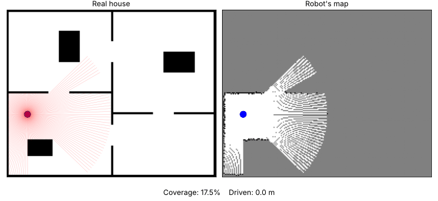
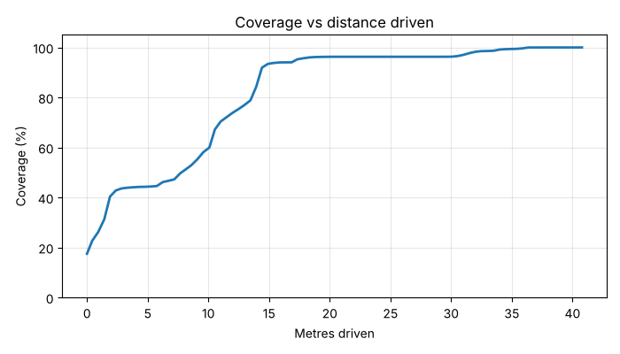

# LiDAR Mapping Simulator

A simulated robot with a spinning laser sensor explores a house on its own, builds a map of it, and plans a path through it.



## How it works

- **LiDAR:** the robot shoots 180 laser beams all around it (one every 2 degrees, up to 4 m) and measures how far each one goes before hitting something.
- **Map:** the house is split into 5 cm squares. Each beam makes the squares it passes through "more free" and the square it hits "more occupied" (an occupancy grid).
- **Frontiers:** the robot drives to the nearest edge between known free space and unknown space, scans again, and repeats until nothing is left to explore.
- **A\*:** once the map is built, the A* algorithm finds the shortest safe path between two points, staying 18 cm away from walls.
- **Noise:** real sensors are not perfect, so random errors are added to every distance. We test how the map holds up with 0, 2, 5 and 10 cm of noise.

## Results

**One scan, radar style** (Step 1)


**Exploration** (Step 2) — numbers in [exploration_stats.md](results/exploration_stats.md)



**Noise test** (Step 3) — numbers in [noise_test.md](results/noise_test.md)


**Path planning** (Step 4)


### Findings

TODO: write in your own words

## Limitations

- The robot always knows exactly where it is. Real SLAM also has to work out the robot's position from its sensors (localization), which is the hardest part. This project does the mapping half.
- 2D only. Real drones and self-driving cars map in 3D.
- Perfect movement: no wheel slip or drift.
- Simple sensor model: Gaussian noise only, with no reflections, glass, sunlight or dark surfaces.
- Nothing in the house moves.

## Next week (hardware)

A VL53L1X laser distance sensor on a servo, connected to an ESP32 or Arduino, sends (angle, distance) readings to a laptop over USB. `update_map` in `mapping.py` turns them into a real map of a room. The servo sweeps 180 degrees instead of 360.

## How to run

```bash
python3 -m venv .venv
```

```bash
.venv/bin/pip install -r requirements.txt
```

```bash
.venv/bin/python radar_demo.py
```

```bash
.venv/bin/python explore_demo.py
```

```bash
.venv/bin/python noise_test.py
```

```bash
.venv/bin/python path_test.py
```

All outputs are saved in `results/`.

## Credits

- Moravec & Elfes (1985), occupancy grid maps
- Yamauchi (1997), frontier-based exploration
- Hart, Nilsson & Raphael (1968), the A* algorithm
