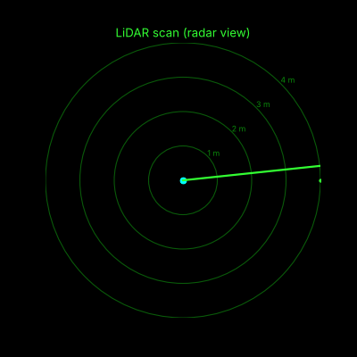
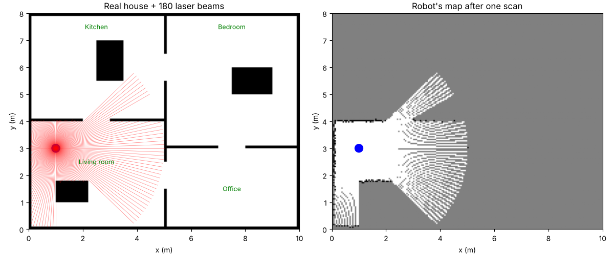
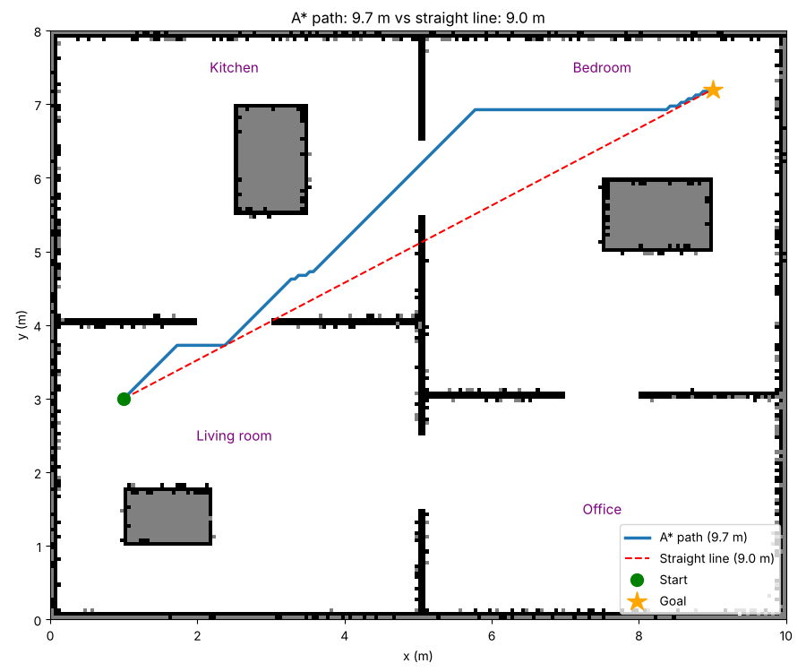

# LiDAR Mapper

Load any floor plan and watch a robot map it with a laser.

**Live site:** https://aashed2408.github.io/Lidar-Mapper/


## How it works

- **LiDAR:** the robot shoots 180 laser beams all around it, one every 2 degrees, and measures how far each one goes before it hits something.
- **Map:** the floor is split into small squares (an occupancy grid). Each beam makes the squares it passes through "more free" and the square it hits "more occupied". Gray means the robot doesn't know yet.
- **Frontiers:** the robot drives to the nearest edge between known free space and unknown space, scans again, and repeats until nothing is left to explore.
- **A\*:** once the map is done, the A* algorithm finds the shortest path to where you click, staying 18 cm away from walls and out of unknown areas.
- **Noise:** real sensors make small mistakes, so a random error is added to every distance. More noise makes the walls on the map thicker and fuzzier.

## Test results

From [results/test_results.md](results/test_results.md) (example house, seed 42):

| Noise (cm) | Scans | Metres | Coverage | Accuracy | Walls found | Bumps |
|---|---|---|---|---|---|---|
| 0 | 87 | 41.8 | 100.0% | 100.0% | 99.5% | 0 |
| 2 | 87 | 41.7 | 100.0% | 99.3% | 98.7% | 0 |
| 5 | 88 | 42.2 | 100.0% | 98.6% | 92.9% | 0 |
| 10 | 118 | 52.4 | 100.0% | 97.1% | 60.9% | 9 |

A* from (1.0, 3.0) to the Bedroom (9.0, 7.2): 9.74 m (straight line: 9.04 m), never closer than 21 cm to a wall.

The tests also check the real-sensor code (Test 6): reading the ESP32's lines, joining lines split across USB chunks, turning angles and distances into beams, and building a map from a pretend sweep.

### Findings

**1. The robot can map a whole house on its own.**
With a normal-quality sensor (about 2 cm of error), the robot explored all four rooms without any help. It saw 100% of the floor, 99.3% of its map was correct, and it never hit a wall. This took 87 scans and about 42 metres of driving.

**2. Most of the map comes quickly. The last corners take the longest.**
The first scan alone shows about a fifth of the house. After 5 metres of driving, the robot had seen about 45% of the floor, and after about 15 metres, more than 90%. The rest of the drive was spent filling in small gaps, such as corners and the spaces behind furniture. In other words, about the last 5% of the map took more than half of the driving.

**3. A worse sensor mostly hurts the walls, not the floor.**
We added more and more random error to the sensor. Even at 10 cm of error, the robot still found 100% of the floor, and its map was still 97% correct. The walls are what suffered. With a perfect sensor, the map found 99.5% of the wall edges. At 10 cm of error, it found only about 61%, and the walls looked patchy and fuzzy. This happens because the map's squares are 5 cm wide. A 10 cm error is two squares, but the map's safety rule only protects one square. So some readings "see through" the surface of a wall and wipe out parts of it.

**4. A worse sensor also makes the robot less safe.**
At 10 cm of error, the robot drove further (52 m instead of 42 m) and bumped into walls 9 times. With 0, 2 or 5 cm of error, it never bumped. The number of bumps depends a lot on luck: running the same test with different random numbers gave anywhere from 0 to 9 bumps. At 10 cm the robot is at risk, but it doesn't crash every time.

**5. The planned path is short and safe.**
To get from the living room to the bedroom, the planner found a 9.7 m path. That is only about 8% longer than a straight line (9.0 m), even though the robot has to go through doorways and keep 18 cm away from every wall. The path never came closer than 21 cm to a wall, and it never went through any area the robot hadn't seen.

**6. The website and the Python version agree.**
With a perfect sensor, both versions give exactly the same results. With a noisy sensor, the numbers are close but not identical, because the two programs use different random numbers. This gives confidence that both versions work correctly.

**7. Uploaded floor plans work, with a few things to watch out for.**
A plan downloaded from the site and uploaded again gives exactly the same map as the built-in house. Very large plans are split into bigger squares (for example 6 cm instead of 5 cm), so the map is a bit less detailed. If a picture has empty space outside the outer walls, the "walls found" score is lower. The robot can never see the outside face of those walls, but the score still counts them.

## Limitations

- The robot always knows exactly where it is. Real SLAM also has to work out the robot's position from its sensors (localization), which is the hardest part. This project does the mapping half.
- 2D only. Real drones and self-driving cars map in 3D.
- Perfect movement: no wheel slip or drift.
- Simple sensor model: Gaussian noise only, with no reflections, glass, sunlight or dark surfaces.
- Nothing in the floor plan moves.
- Uploaded plans are read pixel by pixel, so door arcs, text and symbols become walls.

## Next week (hardware)

A VL53L1X laser distance sensor on a servo, connected to an ESP32 or Arduino, sends (angle, distance) readings to a laptop over USB, and the same `updateMap` logic turns them into a real map of a room. The servo sweeps 180 degrees instead of 360.

## Real hardware

The website has a **Real sensor** mode. A laser distance sensor on a servo sweeps half a circle, the ESP32 sends each angle and distance to the laptop over USB, and the website turns them into a map with the same `updateMap` code the simulation uses.

### Parts list

| Part | What it does |
|---|---|
| ESP32-WROOM-32 DevKit (30-pin, CP2102, USB-C) | The little computer: moves the servo, reads the sensor, talks to the laptop |
| Adafruit VL53L1X time-of-flight sensor | The laser: measures distance up to about 4 m |
| MG90S servo | Turns the sensor from 0 to 180 degrees |
| USB-C **data** cable | Power, and the readings going to the laptop |
| Jumper wires, breadboard | Connections |
| Tape or hot glue | Fixes the sensor to the servo arm |

### Wiring

| From | To (ESP32 pin) |
|---|---|
| VL53L1X VIN | 3V3 |
| VL53L1X GND | GND |
| VL53L1X SDA | GPIO21 |
| VL53L1X SCL | GPIO22 |
| Servo signal (orange) | GPIO18 |
| Servo power (red) | VIN (5 V from USB) |
| Servo ground (brown) | GND |

### How to run it

1. **Upload the code.** Open [firmware/lidar_scanner/lidar_scanner.ino](firmware/lidar_scanner/lidar_scanner.ino) in the Arduino IDE. The guide at the top of the file explains how to add the ESP32 board, install the `Adafruit_VL53L1X` and `ESP32Servo` libraries, and upload.
2. **Attach the servo arm.** After the upload, the servo turns to 90 degrees and waits 5 seconds. Attach the arm with the sensor pointing straight ahead.
3. **Check it in the Serial Monitor (115200 baud).** You should see lines like `90,1234,1` (angle, distance in mm, 1 = good reading) and `SWEEP_END` after each sweep. If you see "sensor not found", check the wiring. **Close the Serial Monitor afterwards**, because only one program can use the USB port at a time.
4. **Open the website in Chrome or Edge on a computer** (Web Serial does not work in Firefox, Safari or on phones). Choose **Real sensor** at the top.
5. **Click the map** where the scanner is in your room, and use the **Scanner faces** slider to set the way it points when the servo is at 90 degrees (90 = up on the map).
6. **Click Connect sensor** and pick the ESP32 (it may be called "CP2102" or "USB to UART"). The ESP32 restarts, waits 5 seconds, and starts sweeping. Green dots appear as the beam sweeps, like a radar.
7. To map more of the room:
   - **Turn 180°:** turn the real scanner around, then click this to scan the other half.
   - **Move scanner:** move the real scanner, click this, then click its new spot on the map.
   - **Flip left/right:** if the map comes out mirrored (a wall on your left shows on the right), click this, then **Clear map**.
   - **Download map as PNG** saves the map.

Tips: walls show as black dotted lines because the beams are 2 degrees apart and spread out further away. Glass, mirrors, shiny and very dark surfaces can give bad readings. If the ESP32 keeps restarting when the servo moves, the USB port may not give enough power: try another port or a powered USB hub.

## How to run

Open the GitHub Pages link. To run it from your own computer, use a local web server, because browsers block JavaScript modules opened straight from a file.

To run the tests (needs Node):

```bash
node tests/test.mjs
```

---

# Python version

The first version of this project: the same simulator in Python, for the example house only. It makes pictures, GIFs and tables instead of a live page.


## Results

**One scan, radar style**





**Exploration**: numbers in [exploration_stats.md](results/exploration_stats.md)


**Noise test**: numbers in [noise_test.md](results/noise_test.md)


**Path planning**



### Findings

**1. One scan only shows the room you are in.**
From its starting spot, a single scan mapped the living room's walls and the couch, plus a little of the kitchen through the open doorway. The rest of the house stayed unknown, because the laser cannot go through walls. This is why the robot has to move around to build a full map.

**2. The robot mapped the whole house without hitting anything.**
With 2 cm of sensor error, the robot saw 100% of the floor after 85 scans and 40.8 metres of driving. 99.3% of its map was correct, and it had 0 bumps. Coverage climbed fast at first (about 44% after 5 m and 96% after 20 m). The last few percent took the longest to fill in.

**3. More sensor error means fuzzier walls.**
In the noise test, the robot still saw 100% of the floor at every level, and accuracy only dropped from 100% to 97%. The walls changed the most. The share of wall edges found fell from 99.5% with a perfect sensor to about 60% at 10 cm of error. The noise test picture shows this clearly: the walls go from thin, sharp lines to thick, speckled ones.

**4. Luck plays a part.**
In this Python run, the robot never bumped into a wall, even at 10 cm of error. It also drove a little less at 5 cm than at 2 cm. When we ran the same test with different random numbers, some runs at 10 cm did bump into walls. Small differences between runs are partly luck, so the overall trend matters more than any single number.

**5. The planned route is close to the shortest possible.**
The path from the living room to the bedroom was 9.7 m long, compared with 9.0 m in a straight line. It went through the doorways and stayed at least 21 cm from every wall.

## How to run

```bash
python3 -m venv .venv
```

```bash
.venv/bin/pip install -r requirements.txt
```

```bash
.venv/bin/python radar_demo.py
```

```bash
.venv/bin/python explore_demo.py
```

```bash
.venv/bin/python noise_test.py
```

```bash
.venv/bin/python path_test.py
```

All outputs are saved in `results/`.

---

## Credits

- Moravec & Elfes (1985), occupancy grid maps
- Yamauchi (1997), frontier-based exploration
- Hart, Nilsson & Raphael (1968), the A* algorithm
