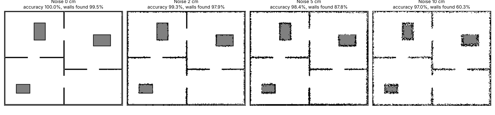

# LiDAR Mapper

Load any floor plan and watch a robot map it with a laser.

**Live site:** https://aashed2408.github.io/Lidar-Mapper/

TODO: add screenshot

## How it works

- **LiDAR:** the robot shoots 180 laser beams all around it, one every 2 degrees, and measures how far each one goes before it hits something.
- **Map:** the floor is split into small squares (an occupancy grid). Each beam makes the squares it passes through "more free" and the square it hits "more occupied". Gray means the robot doesn't know yet.
- **Frontiers:** the robot drives to the nearest edge between known free space and unknown space, scans again, and repeats until nothing is left to explore.
- **A\*:** once the map is done, the A* algorithm finds the shortest path to where you click, staying 18 cm away from walls and out of unknown areas.
- **Noise:** real sensors make small mistakes, so a random error is added to every distance. More noise makes the walls on the map thicker and fuzzier.

## Test results

From [results/test_results.md](results/test_results.md) (example house, seed 42):

| Noise (cm) | Scans | Metres | Coverage | Accuracy | Walls found | Bumps |
|---|---|---|---|---|---|---|
| 0 | 87 | 41.8 | 100.0% | 100.0% | 99.5% | 0 |
| 2 | 87 | 41.7 | 100.0% | 99.3% | 98.7% | 0 |
| 5 | 88 | 42.2 | 100.0% | 98.6% | 92.9% | 0 |
| 10 | 118 | 52.4 | 100.0% | 97.1% | 60.9% | 9 |

A* from (1.0, 3.0) to the Bedroom (9.0, 7.2): 9.74 m (straight line: 9.04 m), never closer than 21 cm to a wall.

### Findings

TODO: write in your own words

## Limitations

- The robot always knows exactly where it is. Real SLAM also has to work out the robot's position from its sensors (localization), which is the hardest part. This project does the mapping half.
- 2D only. Real drones and self-driving cars map in 3D.
- Perfect movement: no wheel slip or drift.
- Simple sensor model: Gaussian noise only, with no reflections, glass, sunlight or dark surfaces.
- Nothing in the floor plan moves.
- Uploaded plans are read pixel by pixel, so door arcs, text and symbols become walls.

## Next week (hardware)

A VL53L1X laser distance sensor on a servo, connected to an ESP32 or Arduino, sends (angle, distance) readings to a laptop over USB, and the same `updateMap` logic turns them into a real map of a room. The servo sweeps 180 degrees instead of 360.

## How to run

Open the GitHub Pages link. To run it from your own computer, use a local web server, because browsers block JavaScript modules opened straight from a file.

To run the tests (needs Node):

```bash
node tests/test.mjs
```

---

# Python version

The first version of this project: the same simulator in Python, for the example house only. It makes pictures, GIFs and tables instead of a live page.


## Results

**One scan, radar style**


**Exploration**: numbers in [exploration_stats.md](results/exploration_stats.md)


**Noise test**: numbers in [noise_test.md](results/noise_test.md)



**Path planning**


### Findings

TODO: write in your own words

## How to run

```bash
python3 -m venv .venv
```

```bash
.venv/bin/pip install -r requirements.txt
```

```bash
.venv/bin/python radar_demo.py
```

```bash
.venv/bin/python explore_demo.py
```

```bash
.venv/bin/python noise_test.py
```

```bash
.venv/bin/python path_test.py
```

All outputs are saved in `results/`.

---

## Credits

- Moravec & Elfes (1985), occupancy grid maps
- Yamauchi (1997), frontier-based exploration
- Hart, Nilsson & Raphael (1968), the A* algorithm
